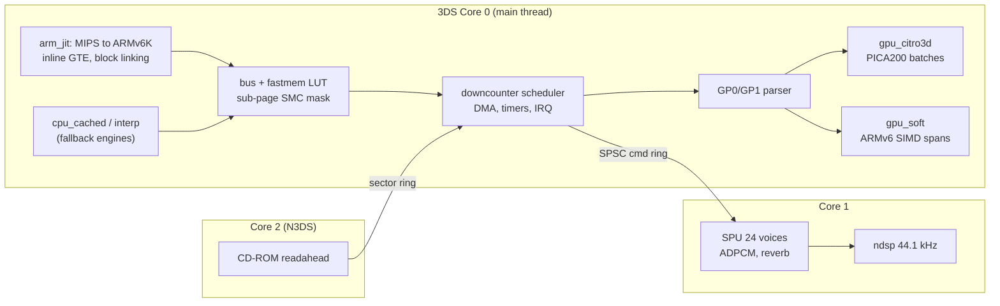

# psx3ds — A PlayStation 1 emulator for Nintendo 3DS, tuned for ARM11

psx3ds is a PlayStation 1 (PSX) emulator for the Nintendo 3DS, written in C11 and ARMv6K
assembly. It is designed around the 3DS ARM11 MPCore CPU (ARMv6K + VFPv2, **no NEON, no ARMv7**)
and the PICA200 GPU:

* **`arm_jit`** recompiles MIPS R3000A code to ARMv6K. It caches 7 MIPS GPRs in host
  registers, uses direct block linking and a software fastmem LUT, and emits **100% of GTE
  commands inline** using `SMLAD`/`SMLALD`.
* **Sub-page self-modifying-code (SMC) tracking.** Each 4 KiB page keeps a 64-byte code-line
  mask, so data writes that land on a code page cost nothing. Steady-state recompiles fell
  from **69 per frame to 0**.
* **Two GPU backends.** `gpu_citro3d` draws on the PICA200 with batch fusion and a Morton
  texture cache that tracks STP per 8×8 tile. `gpu_soft` is a software rasterizer with
  ARMv6 SIMD span kernels (`UQADD8`, `UHADD8`, `USAT`, `PKHBT`) and Bresenham edge walkers
  that never divide.
* **Multi-core 3DS runtime.** Core 0 runs the CPU, GTE and GPU. Core 1 renders the SPU into
  `ndsp`. Core 2 (New 3DS only) prefetches CD-ROM sectors.

The same sources build for three targets, and every change is checked on all three before it
reaches `main`:

| Target | Toolchain | What it is for |
|---|---|---|
| **T1 — Nintendo 3DS** (`psx3ds.3dsx`) | devkitARM `-march=armv6k -mtune=mpcore -mfloat-abi=hard -O3 -flto` | The real product. Tested in `azahar-headless` and meant for real hardware (Luma3DS). |
| **T2 — ARM11 QEMU harness** | Bootlin `armv6-eabihf` GCC run under `qemu-arm -cpu arm11mpcore` | Runs the exact JIT and `.S` kernels on x86_64. Any ARMv7 instruction traps with `SIGILL`. |
| **T3 — x86_64 host CLI** | Host GCC, optionally ASan+UBSan | Interpreter, cached interpreter and portable C paths. Golden tests and sanitizer CI. |

---

## Documentation map

| Document | Contents |
|---|---|
| [`docs/research_modern_psx.md`](docs/research_modern_psx.md) | Survey of modern PSX emulators (DuckStation, Mednafen/Beetle, PCSX-ReARMed, PCSX-Redux, …) and a reference for the PSX hardware (CPU, GTE, GPU, SPU, CD-ROM, MDEC, timing). |
| [`docs/research_3ds_arm_opt.md`](docs/research_3ds_arm_opt.md) | 3DS hardware, ARMv6K SIMD tricks, W^X/JIT on Horizon OS, PICA200 mapping of PSX rendering, multi-core and `ndsp` pipelines. |
| [`docs/ARCHITECTURE.md`](docs/ARCHITECTURE.md) | The normative system spec: module contracts, `PsxCpu` layout, JIT register map, fastmem, scheduler, GPU backends, threading, memory budget. |
| [`docs/BENCHMARKS.md`](docs/BENCHMARKS.md) | Phase 3 vs Phase 4 numbers for CPU engines, inline GTE, SMC, SIMD kernels, PICA200 batching, and memory on O3DS vs N3DS. |
| [`docs/toolchain_env.md`](docs/toolchain_env.md) | Installed SDKs and versions, compile flags, QEMU and Azahar test harnesses, 3DS pitfalls we hit and verified. |
| [`tests/roms/README.md`](tests/roms/README.md) | Inventory of the open-source PSX test ROMs and OpenBIOS used by CI. No Sony BIOS is included. |

---

## Architecture overview



Source layout (see [`docs/ARCHITECTURE.md`](docs/ARCHITECTURE.md) §1 for the full tree and
which slice owns what):

```
include/psx3ds/   shared contract headers (cpu_layout.h offsets shared by C and .S)
src/core/         bus, fastmem, scheduler, IRQ, DMA, timers, interpreter, COP0, GTE reference
src/jit/          block cache, cached interpreter, arm_jit emitter, register allocator, inline GTE
src/gpu/          GP0/GP1 front-end, software rasterizer, ARMv6 span kernels
src/gpu_hw/       citro3d backend, Morton texture cache, psx_gpu.v.pica shader
src/periph/       SPU (+ ARMv6 ADPCM), CD-ROM + readahead, MDEC (+ ARMv6 IDCT), SIO / pad / memcard
src/sys/          system lifecycle, BIOS/HLE, PS-EXE loader, save states, stats, bench
src/platform/     host CLI (PPM/WAV dumps) and 3DS frontend (UI, threads, ndsp, JIT memory)
tests/            ctest unit tests, ROM runner, trace_diff.py, bench_report.py, test ROMs
tools/            env.sh, gen_offsets_check.sh
```

---

## Building

All targets use one CMake project. Load the toolchain environment first (see
[`docs/toolchain_env.md`](docs/toolchain_env.md) for where each SDK is installed):

```bash
source tools/env.sh
```

### T1 — Nintendo 3DS `.3dsx`

```bash
cmake -S . -B build-3ds -G Ninja -DCMAKE_TOOLCHAIN_FILE="${CTR_CMAKE_TOOLCHAIN_FILE}"
ninja -C build-3ds
# -> build-3ds/psx3ds.3dsx, build-3ds/psx3ds.smdh, build-3ds/psx3ds.elf
```

> [!IMPORTANT]
> Do not pass `-DCMAKE_C_FLAGS=...` on T1. It replaces the `-march=armv6k -mtune=mpcore
> -mfloat-abi=hard -mtp=soft` multilib flags set by devkitPro's `3DS.cmake`, and linking then
> fails with `cannot find 3dsx_crt0.o`. To force the Old 3DS memory profile at build time,
> pass `-DPSX3DS_SMALL_MEM=ON`.

### T2 — ARM11 MPCore under QEMU (runs the real JIT on x86_64)

```bash
cmake -S . -B build-t2 -G Ninja -DCMAKE_TOOLCHAIN_FILE=cmake/arm11-linux.cmake
ninja -C build-t2
ctest --test-dir build-t2 --output-on-failure -j8          # runs each test under qemu-arm -cpu arm11mpcore
qemu-arm -cpu arm11mpcore build-t2/psx3ds-cli --bios tests/roms/bios/openbios.bin \
    --exe tests/roms/benchmarks/Cube.exe --cpu jit --frames 600 --dump-ppm /tmp/cube.ppm
```

### T3 — x86_64 host CLI (sanitizers)

```bash
cmake -S . -B build-t3 -G Ninja -DPSX3DS_ENABLE_ASAN=ON -DCMAKE_C_FLAGS="-Werror"
ninja -C build-t3 && ctest --test-dir build-t3 --output-on-failure -j8
build-t3/psx3ds-cli --bios tests/roms/bios/openbios.bin --exe tests/roms/cpu/psxtest_cpu.exe \
    --cpu cached --frames 900 --tty-out -
```

Useful `psx3ds-cli` options (run `psx3ds-cli --help` for all of them):

| Option | Purpose |
|---|---|
| `--cpu interp\|cached\|jit` | Choose the CPU engine (`jit` exists on ARM targets only) |
| `--frames N`, `--stop-on-tty STR` | Run length, or stop when the guest prints a string |
| `--dump-ppm out.ppm[:every]`, `--dump-wav out.wav` | Save frames and 44.1 kHz stereo audio |
| `--bench`, `--bench-json out.json` | Benchmark all engines with JSON telemetry (`psx3ds-bench` runs `--bench` by default) |
| `--trace-hash f --hash-every N` | Write architectural state hashes for `tests/trace_diff.py` |
| `--savestate-test` | Save-state round-trip plus a CRC tamper-rejection check partway through the run |
| `--small-mem` | Use the Old 3DS memory profile (6 MiB JIT cache, 26 MiB arena) |
| `--pad-press f-g:BTN+BTN`, `--input script.txt` | Script controller input deterministically |

### Verification gates (CI order)

1. `tools/gen_offsets_check.sh`: all 34 `PsxCpu` offsets must be identical on x86_64 and ARM11.
2. T3 ASan+UBSan `ctest` and T2 `ctest` under `qemu-arm -cpu arm11mpcore`, with 0 warnings and
   0 `SIGILL`. T1 must build with 0 warnings.
3. ROM gates on T2 with `--cpu jit`, checked against the T3 interpreter: `psxtest_cpu.exe`
   (`Result: 00000101`), `gte-test-all.exe` (1150/1150), `psxtest_gte.exe`, timers, DMA, MDEC,
   SPU ADPCM, and save-state round trips.
4. Real `.3dsx` runs in `azahar-headless` with `psx3ds_autorun.cfg` (see below), using both
   `gpu=hw` and `gpu=soft`, plus an O3DS `small_mem=1` run.

---

## Running on a 3DS

### SD card layout

```
sdmc:/
├── 3ds/
│   ├── psx3ds/psx3ds.3dsx        # the Homebrew Launcher lists any .3dsx under /3ds
│   └── dspfirm.cdc               # DSP firmware dump (needed for audio; otherwise silent)
└── psx3ds/
    ├── bios/                     # SCPH1001.BIN (yours) or openbios.bin (tests/roms/bios/)
    ├── roms/                     # *.cue / *.bin / *.iso / *.img / *.exe / *.psx
    ├── saves/                    # save states: <game>_slot<N>.st
    └── memcards/                 # 128 KiB raw memory-card images
```

The ROM browser also scans `sdmc:/psx`, `sdmc:/roms/psx` and `sdmc:/`. BIOS lookup tries
`sdmc:/psx3ds/bios/`, `sdmc:/psx/`, `sdmc:/bios/` and `sdmc:/`, preferring `SCPH1001.BIN` over
`openbios.bin`. If no BIOS is found, the built-in HLE BIOS is used. The emulator creates the
`psx3ds/` directories on first launch.

> [!NOTE]
> Run the `.3dsx` through the Homebrew Launcher on **Luma3DS**. psx3ds checks at startup which
> JIT memory mode is available (Luma's mirror-mapped RW/RX first, then RWX in place). If neither
> works, it falls back to the cached interpreter, so it never crashes on a restricted system.
> Old 3DS units are detected automatically and get the `small_mem` profile.

### Controls

| 3DS | PlayStation |
|---|---|
| D-Pad / Circle Pad | D-Pad (the Circle Pad is also the left analog stick) |
| A / B / X / Y | Circle / Cross / Triangle / Square |
| L / R | L1 / R1 |
| ZL / ZR (N3DS), or bottom-screen touch pads (O3DS) | L2 / R2 |
| C-Stick (N3DS) | Right analog stick |
| L + R + Y, or bottom-screen touch pads | L3 + R3 |
| START / SELECT | START / SELECT |
| START + SELECT | Open the Quick Controls tab on the bottom screen |
| L + R + X | Quick save state to the current slot |

The bottom touch screen has three tabs:

* **ROM browser**: D-Pad and A, or tap to select. X rescans the SD card. There is also a
  "Boot BIOS shell" button.
* **Live telemetry**: FPS, emulation speed, JIT blocks and code size, SMC counters, SPU ring
  fill, and the JIT memory mode.
* **Quick Controls**: switch GPU between HW (PICA200) and SW (ARMv6), aspect ratio
  (1:1 / stretch / 4:3), frameskip, SPU reverb, save-state slots 0–3, save, load, and reset.

### Headless `.3dsx` testing (`psx3ds_autorun.cfg`)

If `sdmc:/psx3ds_autorun.cfg` exists, the `.3dsx` skips the UI. It runs one title for a fixed
number of frames, writes artifacts, and exits. This is how CI drives `azahar-headless`:

```ini
bios=sdmc:/bios/openbios.bin     # or: bios=hle
exe=sdmc:/roms/Cube.exe          # or: cd=sdmc:/roms/game.cue
cpu=jit                          # jit | cached | interp
gpu=hw                           # hw | soft
frames=220
small_mem=1                      # optional: force the Old-3DS profile (0 = force N3DS profile)
ppm=sdmc:/screen.ppm             # 400x240 un-rotated top-screen capture
json=sdmc:/result.json           # PsxStats telemetry (fps, batches, texcache, JIT, SPU underruns…)
tty=sdmc:/tty.txt
done=sdmc:/done.txt              # written last: "OK frames=… jit_mem_mode=… cpu_mode=…"
```

```bash
azahar-headless build-3ds/psx3ds.3dsx --sdmc /tmp/sdmc --done-file done.txt --timeout 120
```

---

## Optimization highlights

Measured numbers, including before/after tables, are in [`docs/BENCHMARKS.md`](docs/BENCHMARKS.md).

| Optimization / Subsystem | Measured Result |
|---|---|
| **`arm_jit` MIPS → ARM11v6K throughput** (`test_jit_core`, T2) | **`71.01×`** faster than interpreter (`10.39×` vs cached interpreter); `35.4×` full-system on `Cube.exe` |
| **Sub-page 64B SMC code-line bitmask** (`Cube` / `PSXNICCC` steady-state, T2) | Recompiles dropped **`69/frame → 0/frame`**, boosting steady-state `jit` FPS **`8.65×`** (`91.2 → 788.8 FPS` on `Cube`) and **`5.03×`** (`102.0 → 512.7 FPS` on `PSXNICCC`) |
| **100% inline ARMv6K GTE** (all 22 GTE opcodes, `r0–r8`-only) | **`100.0%`** inline GTE in `animated-triangle` (up from `71.4%`); **`5.90×`** faster than interpreter (`2.81×` vs C helper) with **1,150 / 1,150** `gte-test-all` accuracy |
| **ARMv6K SIMD kernels & zero-div rasterizer** (T2 `gpu_soft` / MDEC / SPU) | MDEC IDCT **`2.66×`**, dithered Gouraud span **`1.99×`**, 4bpp sprite row **`1.94×`**, Gouraud span **`1.79×`**, ABR1 **`1.61×`**, `gpu-benchmark` **`169.9 FPS`** (`12.1×` vs `interp`) |
| **PICA200 `citro3d` HW GPU + batch fusion** (T1 `.3dsx` in Azahar) | **`2.5×–3.5×`** faster than ARMv6K software GPU (`Cube` **`115.2 FPS`**, `PSXNICCC` **`119.0 FPS`**), draw calls cut **`17–33%`**, Core 1 SPU underruns cut **`92–97%`** |
| **Old 3DS `small_mem` 64 MiB profile** (`26 MiB` arena + 20-slot `RGBA5551`) | Sustains 600-frame `.3dsx` runs in **`< 30 MiB` FCRAM** using only **`291–402 KiB`** of the `6 MiB` JIT buffer (`0` post-boot flushes) |

Design decisions that make these numbers possible (details in
[`docs/ARCHITECTURE.md`](docs/ARCHITECTURE.md) and
[`docs/research_3ds_arm_opt.md`](docs/research_3ds_arm_opt.md)):

* **No instruction is rewritten after commit.** The JIT code cache is append-only. Direct `B`
  links are only made to targets whose pages are a subset of the caller's pages, so
  invalidating a page never leaves a stale branch. Azahar's Dynarmic and the real ARM11
  I-cache both stay coherent without per-block cache SVCs.
* **Load-delay slots, branch-delay slots, `LWL/LWR`, COP0 and IRQ latency follow the
  R3000A exactly**, and `trace_diff.py` checks the JIT against the interpreter hash for hash.
* **GTE is bit-exact.** It uses 64-bit `SMLALD` MACs and computes 44-bit overflow flags in 3
  instructions. The UNR divide is a `CLZ` leaf. RTPS IR3 and MVMVA `cv=2` quirks are
  reproduced.
* **PICA200 mapping**: `RGBA5551` and `RGBA8` Morton texture pages; per-tile STP masks split
  only truly mixed semi-transparent prims into two passes; untextured prims bind an 8×8 white
  texture so they share batches with textured ones; 12-byte vertices.
* **SPU on Core 1**: an SPSC register-command ring, an LDREX/STREX render lock, and IRQ9
  latched for delivery on Core 0, giving 44.1 kHz `ndsp` output with very few underruns.

---

## Legal

psx3ds contains no Sony code or BIOS. The CI BIOS is the MIT-licensed PCSX-Redux **OpenBIOS**
(`tests/roms/bios/LICENSE.openbios`). All test ROMs in `tests/roms/` are freely redistributable
homebrew or open-source test suites (see [`tests/roms/README.md`](tests/roms/README.md)). Use a
BIOS dumped from your own console and games you own.
