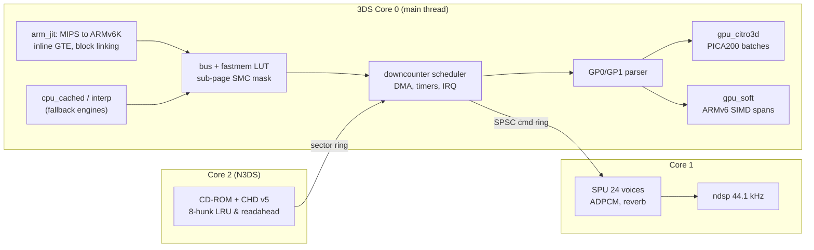

# psx3ds — A PlayStation 1 emulator for Nintendo 3DS, tuned for ARM11 (`v0.2.7`)

psx3ds is a PlayStation 1 (PSX) emulator for the Nintendo 3DS, written in C11 and ARMv6K
assembly. It is designed around the 3DS ARM11 MPCore CPU (ARMv6K + VFPv2, **no NEON, no ARMv7**)
and the PICA200 GPU:

* **`arm_jit`** recompiles MIPS R3000A code to ARM11v6K. It caches 7 MIPS GPRs in host
  registers, uses direct block linking and a software fastmem LUT, and emits **100% of GTE
  commands inline** using `SMLAD`/`SMLALD`.
* **Sub-page self-modifying-code (SMC) tracking.** Each 4 KiB page keeps a 64-byte code-line
  mask, so data writes that land on a code page cost nothing. Steady-state recompiles fell
  from **69 per frame to 0**.
* **Two GPU backends.** `gpu_citro3d` draws on the PICA200 with batch fusion and a Morton
  texture cache that tracks STP per 8×8 tile. `gpu_soft` is a software rasterizer with
  ARMv6 SIMD span kernels (`UQADD8`, `UHADD8`, `USAT`, `PKHBT`) and Bresenham edge walkers
  that never divide.
* **Compressed CHD v1–v5 disc streaming.** Built-in `libchdr` supports all four CHD v5 CD
  codecs (`cdzl` Deflate, `cdlz` LZMA, `cdzs` Zstd, `cdfl` FLAC + Subcode) plus v1–v4,
  4-sector track padding remapping, ARMv6K `REV16` CD-DA endianness conversion, an 8-hunk
  LRU cache (4-hunk on Old 3DS; `87.5%` sequential cold hit rate), and asynchronous Core 2
  decompression.
* **Installable universal `.cia` & Homebrew `.3dsx`.** Installing `psx3ds.cia` via FBI on
  Luma3DS unlocks native Horizon OS `SVC 0x70` hardware W^X dual-mapped RW+RX JIT
  (`JIT_MEM_MIRROR_RWRX`), New 3DS 804 MHz clock / 124 MiB FCRAM / 2 MiB L2 / Core 2 /
  C-Stick & ZL/ZR (`ir:rst`, `qtm:s`), while remaining 100% compatible with Old 3DS (268 MHz,
  64 MiB `small_mem`).
* **Multi-core 3DS runtime.** Core 0 runs the CPU, GTE and GPU. Core 1 renders the SPU into
  `ndsp`. Core 2 (New 3DS only) prefetches and decompresses CD-ROM / `.chd` sectors.

The same sources build for three targets, and every change is checked on all three before it
reaches `main`:

| Target | Toolchain | What it is for |
|---|---|---|
| **T1 — Nintendo 3DS** (`psx3ds.cia`, `psx3ds.3dsx`, `psx3ds.cci`) | devkitARM `-march=armv6k -mtune=mpcore -mfloat-abi=hard -O3 -flto` + `makerom` / `bannertool` | The real product. Tested as both `.cci` (NCCH/ExHeader) and `.3dsx` in `azahar-headless`, and built for real New 3DS & Old 3DS hardware (Luma3DS). |
| **T2 — ARM11 QEMU harness** | Bootlin `armv6-eabihf` GCC run under `qemu-arm -cpu arm11mpcore` | Runs the exact JIT, `.S` kernels, and CHD v5 decoders on x86_64. Any ARMv7 instruction traps with `SIGILL`. |
| **T3 — x86_64 host CLI** | Host GCC, optionally ASan+UBSan | Interpreter, cached interpreter and portable C paths. Golden tests and sanitizer CI. |

---

## Documentation map

| Document | Contents |
|---|---|
| [`docs/research_modern_psx.md`](docs/research_modern_psx.md) | Survey of modern PSX emulators (DuckStation, Mednafen/Beetle, PCSX-ReARMed, PCSX-Redux, …) and a reference for the PSX hardware (CPU, GTE, GPU, SPU, CD-ROM, MDEC, timing). |
| [`docs/research_3ds_arm_opt.md`](docs/research_3ds_arm_opt.md) | 3DS hardware, ARMv6K SIMD tricks, W^X/JIT on Horizon OS, PICA200 mapping of PSX rendering, multi-core and `ndsp` pipelines. |
| [`docs/ARCHITECTURE.md`](docs/ARCHITECTURE.md) | The normative system spec: module contracts, `PsxCpu` layout, JIT register map, fastmem, scheduler, GPU backends, threading, memory budget. |
| [`docs/BENCHMARKS.md`](docs/BENCHMARKS.md) | Phase 3 vs Phase 4 numbers for CPU engines, inline GTE, SMC, SIMD kernels, PICA200 batching, and memory on O3DS vs N3DS. |
| [`docs/toolchain_env.md`](docs/toolchain_env.md) | Installed SDKs and versions, compile flags, QEMU and Azahar test harnesses, 3DS pitfalls we hit and verified. |
| [`tests/roms/README.md`](tests/roms/README.md) | Inventory of the open-source PSX test ROMs and OpenBIOS used by CI. No Sony BIOS is included. |

---

## Architecture overview



Source layout (see [`docs/ARCHITECTURE.md`](docs/ARCHITECTURE.md) §1 for the full tree and
which slice owns what):

```
include/psx3ds/   shared contract headers (cpu_layout.h offsets shared by C and .S)
src/core/         bus, fastmem, scheduler, IRQ, DMA, timers, interpreter, COP0, GTE reference
src/jit/          block cache, cached interpreter, arm_jit emitter, register allocator, inline GTE
src/gpu/          GP0/GP1 front-end, software rasterizer, ARMv6 span kernels
src/gpu_hw/       citro3d backend, Morton texture cache, psx_gpu.v.pica shader
src/periph/       SPU (+ ARMv6 ADPCM), CD-ROM + CHD v5 + readahead, MDEC (+ ARMv6 IDCT), SIO / pad / memcard
src/sys/          system lifecycle, BIOS/HLE, PS-EXE loader, save states, stats, bench
src/platform/     host CLI (PPM/WAV dumps) and 3DS frontend (UI, threads, ndsp, JIT memory)
assets/3ds/       CIA/CCI RSF ExHeader spec, 48x48 SMDH icon, 256x128 banner & boot chime
cmake/            ARM11 QEMU toolchain, libchdr codec build rules, 3DS .cia/.cci packaging
third_party/      vendored libchdr v0.3.0 (+ miniz/LZMA/zstd/dr_flac for host & QEMU targets)
tests/            19 ctest unit suites, ROM runner, trace_diff.py, bench_report.py, test ROMs
tools/            env.sh, gen_offsets_check.sh, gen_cia_assets.py
```

---

## Building

All targets use one CMake project. Load the toolchain environment first (see
[`docs/toolchain_env.md`](docs/toolchain_env.md) for where each SDK is installed):

```bash
source tools/env.sh
```

### T1 — Nintendo 3DS (`.cia`, `.3dsx`, `.cci`)

```bash
cmake -S . -B build-3ds -G Ninja \
    -DCMAKE_TOOLCHAIN_FILE="${CTR_CMAKE_TOOLCHAIN_FILE}" \
    -DCMAKE_BUILD_TYPE=Release
ninja -C build-3ds
# -> build-3ds/psx3ds.cia   (installable via FBI on Luma3DS New 3DS & Old 3DS)
# -> build-3ds/psx3ds.3dsx  (Homebrew Launcher executable w/ embedded custom SMDH)
# -> build-3ds/psx3ds.cci   (NCCH cartridge image w/ full RSF ExHeader for Azahar/Citra)
# -> build-3ds/psx3ds.smdh, build-3ds/psx3ds.bnr, build-3ds/psx3ds.elf
```

T1 links devkitPro's `3ds-zlib`, `3ds-xz`, `3ds-zstd`, and `3ds-flac` portlibs for CHD v1–v5
decompression, and automatically packages `.cia`/`.cci` when `makerom` and `bannertool` are
installed in `$DEVKITPRO/tools/bin` (pass `-DPSX3DS_BUILD_CIA=OFF` to build `.3dsx` only).

> [!IMPORTANT]
> Do not pass `-DCMAKE_C_FLAGS=...` on T1. It replaces the `-march=armv6k -mtune=mpcore
> -mfloat-abi=hard -mtp=soft` multilib flags set by devkitPro's `3DS.cmake`, and linking then
> fails with `cannot find 3dsx_crt0.o`. To force the Old 3DS memory profile at build time,
> pass `-DPSX3DS_SMALL_MEM=ON`.

### T2 — ARM11 MPCore under QEMU (runs the real JIT on x86_64)

```bash
cmake -S . -B build-t2 -G Ninja -DCMAKE_TOOLCHAIN_FILE=cmake/arm11-linux.cmake
ninja -C build-t2
ctest --test-dir build-t2 --output-on-failure -j8          # runs each test under qemu-arm -cpu arm11mpcore
qemu-arm -cpu arm11mpcore build-t2/psx3ds-cli --bios tests/roms/bios/openbios.bin \
    --exe tests/roms/benchmarks/Cube.exe --cpu jit --frames 600 --dump-ppm /tmp/cube.ppm
```

### T3 — x86_64 host CLI (sanitizers)

```bash
cmake -S . -B build-t3 -G Ninja -DPSX3DS_ENABLE_ASAN=ON -DCMAKE_C_FLAGS="-Werror"
ninja -C build-t3 && ctest --test-dir build-t3 --output-on-failure -j8
build-t3/psx3ds-cli --bios tests/roms/bios/openbios.bin --exe tests/roms/cpu/psxtest_cpu.exe \
    --cpu cached --frames 900 --tty-out -
```

Useful `psx3ds-cli` options (run `psx3ds-cli --help` for all of them):

| Option | Purpose |
|---|---|
| `--cpu interp\|cached\|jit` | Choose the CPU engine (`jit` exists on ARM targets only) |
| `--cd <disc.chd\|.cue\|.bin\|.iso>` | Mount a CHD v1–v5 archive, CUE/BIN multi-track set, or raw ISO/IMG |
| `--frames N`, `--stop-on-tty STR` | Run length, or stop when the guest prints a string |
| `--dump-ppm out.ppm[:every]`, `--dump-wav out.wav` | Save frames and 44.1 kHz stereo audio |
| `--bench`, `--bench-json out.json` | Benchmark all engines with JSON telemetry (`psx3ds-bench` runs `--bench` by default) |
| `--trace-hash f --hash-every N` | Write architectural state hashes for `tests/trace_diff.py` |
| `--savestate-test` | Save-state round-trip plus a CRC tamper-rejection check partway through the run |
| `--small-mem` | Use the Old 3DS memory profile (6 MiB JIT cache, 26 MiB arena) |
| `--pad-press f-g:BTN+BTN`, `--input script.txt` | Script controller input deterministically |

### Verification gates (CI order)

1. `tools/gen_offsets_check.sh`: all 34 `PsxCpu` offsets must be identical on x86_64 and ARM11.
2. **19/19** `ctest` suites (including `test_periph_chd` covering all four CHD v5 codecs + LRU cache)
   on T3 ASan+UBSan and T2 `qemu-arm -cpu arm11mpcore`, with 0 warnings and 0 `SIGILL`. T1 builds
   `psx3ds.cia`, `psx3ds.3dsx`, `psx3ds.cci`, and `psx3ds.smdh` with 0 compiler warnings.
3. ROM gates on T2 with `--cpu jit`, checked against the T3 interpreter: `psxtest_cpu.exe`
   (`Result: 00000101`), `gte-test-all.exe` (1150/1150), `psxtest_gte.exe`, timers, DMA, MDEC,
   SPU ADPCM, CHD v5 disc mounting (`--cd *.chd`), and save-state round trips.
4. Real `.cci` (exact `.cia` NCCH + RSF ExHeader `SVC 0x70` permissions) and `.3dsx` runs in
   `azahar-headless` with `psx3ds_autorun.cfg`, across New 3DS (`124 MiB`), Old 3DS (`64 MiB`,
   `small_mem=1`), `gpu=hw` / `gpu=soft`, and `.chd` disc images.

---

## Running on a 3DS

### Installation (CIA via FBI or 3DSX via Homebrew Launcher)

Grab the latest release bundle (`psx3ds-v0.2.7-3ds.zip` or standalone `psx3ds.cia` / `psx3ds.3dsx`)
from [**GitHub Releases**](https://github.com/codescv/psx3ds/releases):

* **Option A — Installable `.cia` (Recommended on Luma3DS, New 3DS & Old 3DS):**
  1. Copy `psx3ds.cia` to `sdmc:/cia/psx3ds.cia` (or extract `psx3ds-v0.2.7-3ds.zip` to the root
     of your SD card).
  2. Open **FBI** → `SD` → `cia` → `psx3ds.cia` → **Install and delete CIA**, then launch
     **PSX3DS** from the 3DS Home Menu.
  3. The universal ExHeader (`TitleID 000400000F853D00`) automatically unlocks native **`SVC 0x70`
     hardware W^X dual-mapped RW+RX JIT (`JIT_MEM_MIRROR_RWRX`)**, **New 3DS 804 MHz / 124 MiB
     FCRAM / 2 MiB L2 / Core 2** CD/CHD prefetch, and **`ir:rst` + `qtm:s`** (C-Stick & ZL/ZR),
     while seamlessly running on **Old 3DS / 2DS (`SystemMode: 64MB`, 268 MHz)** using the `small_mem`
     memory profile.
* **Option B — Homebrew Launcher `.3dsx`:**
  Copy `psx3ds.3dsx` and `psx3ds.smdh` into `sdmc:/3ds/psx3ds/` and launch from the Luma3DS
  Homebrew Menu (`hbmenu`).

### SD card layout & CHD compression

```
sdmc:/
├── cia/
│   └── psx3ds.cia                # install via FBI for Home Menu + native SVC 0x70 W^X JIT
├── 3ds/
│   ├── psx3ds/
│   │   ├── psx3ds.3dsx           # Homebrew Launcher executable
│   │   └── psx3ds.smdh           # icon & title metadata
│   └── dspfirm.cdc               # DSP firmware dump (needed for audio; otherwise silent)
└── psx3ds/
    ├── bios/                     # optional: your SCPH*.BIN (OpenBIOS is built in)
    ├── roms/                     # *.chd (recommended) / *.cue + *.bin / *.iso / *.img / *.exe
    ├── saves/                    # save states: <game>_slot<N>.st
    └── memcards/                 # 128 KiB raw memory-card images
```

To compress multi-bin `.cue`/`.bin` PlayStation dumps into single-file **CHD v5** archives
(typically **40–60% smaller** on SD card with lossless FLAC CD-DA audio):

```bash
chdman createcd -i "Game Title.cue" -o "Game Title.chd"
```

All CHD v1–v5 CD codecs (`cdzl` Deflate, `cdlz` LZMA, `cdzs` Zstd, `cdfl` FLAC) are decoded natively
with an 8-hunk LRU cache on New 3DS (`~1.2 MiB`, Core 2 async offload) and a 4-hunk cache on Old 3DS
(`~0.6 MiB`); `.chd` titles show a `[CHD]` badge in the ROM browser and live cache hit rates on the
telemetry HUD.

The ROM browser scans only `sdmc:/psx3ds/roms`, `sdmc:/roms/psx` and `sdmc:/psx` (`v0.2.3`: the SD
card root is no longer scanned).

**BIOS (`v0.2.2`): no setup required.** A 512 KiB **OpenBIOS** image (MIT, PCSX-Redux) is embedded
directly in `psx3ds.cia` / `.3dsx` / `.cci`, so `.chd` / `.cue` / `.bin` / `.iso` discs boot out of the
box (header badge `[OPENBIOS]`). If you place your own 512 KiB BIOS dump (`scph*.bin`, `psxonpsp*.bin`,
`bios*.bin`; any case) in `sdmc:/psx3ds/bios/`, `sdmc:/bios/`, `sdmc:/psx3ds/roms/`, `sdmc:/roms/psx/`
or `sdmc:/psx/` (never the SD root), it is used instead (badge e.g. `[SCPH1001]`, `[SCPH5501]`). The `3:CTRL` tab toggles
`BIOS: Auto/OpenBIOS` ↔ `BIOS: HLE Direct` and `CD Boot: Native` ↔ `CD Boot: Fast`:

* **Native** (default): the BIOS kernel boots, the BIOS shell/logo is skipped, and the BIOS reads
  `SYSTEM.CNF` → `BOOT = cdrom:\...` → PS-X EXE through the emulated CD-ROM controller (exactly like
  hardware; ~3 s for an 800 KB EXE). A watchdog sideloads the EXE if the BIOS stalls for 30 s.
* **Fast**: psx3ds parses ISO9660 itself and sideloads the boot EXE at the BIOS shell entry
  (`0x80030000`) right after kernel init.
* **HLE Direct**: no BIOS at all; psx3ds loads the disc's boot EXE straight into RAM and emulates
  the kernel (events, pads, `cdrom:` `open`/`read`/`Load`/`LoadExec`). Fastest, least compatible.

**Debugging a black screen:** the `2:HUD` tab shows `PC`, `CD Rd` (sectors read) and `IRQ` state, and
the `4:LOG` tab shows the boot log (`[bios]`, `[cdboot] SYSTEM.CNF BOOT=...`, `[cdrom]`, `[hle]`, guest
`[tty]` output). The full log is also written to `sdmc:/psx3ds/psx3ds.log` (`Dump Log` saves
`sdmc:/psx3ds/psx3ds_dump.log`) — a photo of `2:HUD` + `4:LOG` is the best bug report.
The emulator creates the `psx3ds/` directories on first launch.

> [!NOTE]
> At startup `psx3ds` probes Horizon OS JIT permissions in order: hardware W^X dual-mapped RW+RX
> mirror (`SVC 0x70 MEMOP_MAP`, active on `.cia` and Rosalina Luma3DS), then in-place RWX
> (`MEMOP_PROT`), falling back safely to the cached interpreter if running inside a restricted
> environment so it never crashes. Old 3DS units are detected automatically and run the `small_mem`
> profile (`20 MiB` linear heap + `42.6 MiB` normal heap fitting `26 MiB` arena + `6 MiB` JIT + CHD);
> New 3DS gets an `80 MiB` normal heap + `42.6 MiB` linear heap (`v0.2.1` fixes the `v0.2.0` boot
> crash where the normal heap overflowed the 96 MiB Kernel11 heap window on New 3DS).

> [!NOTE]
> **`v0.2.3` real-hardware JIT fix (New 3DS `prefetch abort` at `PC = 0x08067E70`):** `v0.2.2`'s
> `jit_mem_commit()` only cleaned the D-cache, never invalidating the ARM11 L1 I-cache, and blocks
> were packed at 4-byte granularity, so a freshly emitted block could run a stale I-cache line of zero
> words (`andeq r0, r0, r0`), skipping a helper `blx`/`pop` and leaving `SP` 8 bytes off at
> `jit_exit`. `v0.2.3` (1) cleans the D-cache of both the RW and RX views and invalidates the L1
> I-cache + BTB (Luma3DS `SVC 0x94`) + `DSB`/`ISB` on every block commit, (2) allocates the RW code
> buffer 16 KiB aligned so it shares VIPT cache colours with the 1 MiB-aligned RX mirror, (3) pads
> every block to a 32-byte cache line, and (4) saves `SP` in `jit_enter` (`PsxCpu.jit_saved_sp`,
> offset `0x270`) and restores it in every `jit_exit*` path before `pop {r4-r12, pc}`.

> [!NOTE]
> **`v0.2.7` fixes (real New 3DS: `libctru` NDSP stop-race & D-cache coherency; *Winning Eleven 4* anti-modchip lockout):**
> - **Real-hardware NDSP audio:** `libctru`'s `ndspiReadChnState` retires the final wavebuf with
>   `wavebuf_queued_count = 0` while leaving `chn->playing = 1`, so queuing silence buffers in the
>   ROM menu (or draining during BIOS boot) caused later `ndspChnWaveBufAdd` calls without
>   `ndspChnWaveBufClear` to stick in `NDSP_WBUF_PLAYING` on a stopped DSP channel forever. `v0.2.7`
>   drops menu silence buffers, calls `ndspChnWaveBufClear` before every game boot and underrun/stall
>   re-prime (`150 ms` / `35 ms` watchdog), splits Core 1 (`ctr_audio_render_core1` SPU-only) from
>   Core 0 (exclusive wavebuf owner, pumped every `<= 4 ms` slice of `pacer_wait`, flushing Core 0's
>   L1/L2 cache directly via Kernel11 `svcFlushProcessDataCache` instead of racing `dspHandle`),
>   makes async SPU `ENDX`/voice readback coherent on Core 0, and adds live `WB:sub/act Pk:n`
>   diagnostics on `2:HUD`.
> - ***Winning Eleven 4* (`SLPM_862.91`) anti-modchip fix:** `CD-ROM Test 0x19 0x05`
>   (`GetSCExCounters`) now returns `{ stat, 0x00, 0x00 }` outside the Lead-In (`cur_lba >= 150`) or
>   while playing/reading, matching genuine PS1 hardware instead of tripping 1999+ modchip checks.

> [!NOTE]
> **`v0.2.6` fixes (real New 3DS: no sound, 30–80 FPS jitter):**
> - **Audio on real hardware:** the Core 1 (SysCore) SPU worker ran at `main_prio + 1` (`0x31`),
>   below the `0x30` APT SysCore quota thread, and was starved (or silently fell back to Core 0,
>   where `main()` never yields) while the HUD still said `ASYNC`. It now runs at `main_prio - 1`
>   (`0x2F`) with a Core 1 priority ladder and a sleeping-worker-safe Core 0 fallback; the HUD only
>   shows `ASYNC` when the worker really is on Core 1. Core 0 also pumps the (trylock-guarded) NDSP
>   feeder once per frame as a backstop.
> - **NDSP feeder:** 4 x 735-frame wavebufs (66.7 ms), refilled in strict FIFO order and only with a
>   full buffer of real samples — partial buffers are no longer padded with flat DC (which locked
>   NDSP into tens of ms of silence). A gentle (≤ 1.1%) resample keeps latency bounded under the
>   60.00 Hz lock.
> - **Steady 60 FPS:** a drift-free 60.00 Hz (PAL 50.00 Hz) wall-clock pacer with a 2-frame catch-up
>   window replaces the uncapped loop, and empty odd frames of 30 Hz `VSync(2)` games no longer wait
>   an extra VBlank in `C3D_FRAME_SYNCDRAW`. The HUD shows a 32-frame rolling average (even and odd
>   frames weighted equally) and redraws every 15th frame (odd divisor).

> [!NOTE]
> **`v0.2.5` fixes (Winning Eleven 3 ~20 FPS and texture glitches on real New 3DS):**
> - **No-op `GP0(80h)`:** WE3 ends every frame with an unmasked `(0,0)->(0,0) 2x512` self-copy;
>   it used to force a full GPU->shadow readback plus a CPU re-upload (two PICA200 stalls/frame).
>   It is now skipped (`gpu_vram_copy_is_noop`); masked `GP0(A0h)` loads sync the destination first.
> - **Early scissor culling:** primitives fully outside the drawing area (~39% of WE3 match draws)
>   are dropped before any texture decode; CPU-upload flushes use the clipped primitive bbox.
> - **Fewer GPU syncs:** one vertex D-cache flush per frame submission (was one GSPGPU IPC per batch),
>   `upload_tex` rewrites only stall when the open frame already sampled it and flush only the dirty
>   tile rows, 8192-vertex rings, one ARM11 I-cache invalidate per eager JIT compile (was per block),
>   and the bottom-screen UI redraws at ~3.75 Hz while idle in game.
> - **Texture cache:** stale CLUT-dirty slots (animated palettes) are recycled before any clean,
>   live page is evicted; New 3DS uses 128 lazily allocated slots capped at 24 MiB of LINEAR RAM.
> - **Texel-exact sampling:** UVs are 1/16-texel fixed point, VRAM-pass geometry is shifted by 7/16 px
>   to sample at PS1 integer pixel positions, polygons get the PS1 `floor(u + 0.5)` lookup with the
>   gradient correction (minified shadows no longer turn into dotted lines), and integral `v` no longer
>   fetches row `v - 1` (or wraps `v = 0` to row 255). The WE3 menus/dialogs now match `gpu_soft`
>   pixel-for-pixel in Azahar.

> [!NOTE]
> **`v0.2.4` fixes (Winning Eleven 3 freeze after the logo, HOME -> Close hang):**
> - **480i `VSync(0)` freeze:** `sys->gpu.frame` was advanced twice per frame (at VBlank entry in
>   `gpu_on_vblank()` *and* at scanline 0 in `timers_hblank_cb()`), so in interlaced 480i mode the
>   field parity never changed during active video and `GPUSTAT` bit 31 stayed `0`; Psy-Q `VSync(0)`
>   spins until bit 31 toggles and hung forever. The field now advances exactly once per frame, and
>   `GPUSTAT` bits 13/31 are latched before `IRQ0` (VBlank) is raised.
> - **FMV `MDEC_in_sync timeout`:** Psy-Q arms `DecDCTout()` (DMA1, SyncMode 1) before
>   `DecDCTin()` (DMA0). DMA1 is now paced by the MDEC Data-Out request: it stays armed until decoded
>   words exist (MDEC wakes it), instead of draining zeros early and stranding a decoded slice.
> - **HOME -> Close hang ("Closing software..."):** the citro3d backend submits any open frame on
>   `APTHOOK_ONSUSPEND` and never calls `C3D_FrameSync()` / `C3D_FrameBegin()` unless
>   `aptIsActive() && !aptShouldClose()`. The Core 1 (SysCore) SPU worker now runs below the main
>   thread priority, and both worker threads idle (no NDSP/DSP/SDMC access) while suspended/asleep.
> - **PICA200 title-screen stripes (368 px modes):** an 8bpp TexPage at `tp_x = 960` was treated as
>   wrapping onto the framebuffer at `X = 0..63`, forcing a GPU readback that also copied *non-dirty*
>   cells back into shadow VRAM with the STP bit forced to 1 (odd 8bpp texels gained `+128`). TexPage
>   coherence is now clamped at `X = 1023`, readback only touches GPU-dirty 16x16 cells (whole cells),
>   and CPU uploads re-upload exact 8x8 tiles instead of one bounding box.

### Controls

| 3DS | PlayStation |
|---|---|
| D-Pad / Circle Pad | D-Pad (the Circle Pad is also the left analog stick) |
| A / B / X / Y | Circle / Cross / Triangle / Square |
| L / R | L1 / R1 |
| ZL / ZR (N3DS), or bottom-screen touch pads (O3DS) | L2 / R2 |
| C-Stick (N3DS) | Right analog stick |
| L + R + Y, or bottom-screen touch pads | L3 + R3 |
| START / SELECT | START / SELECT |
| START + SELECT | Open the Quick Controls tab on the bottom screen |
| L + R + X | Quick save state to the current slot |

The bottom touch screen has three tabs:

* **ROM browser**: D-Pad and A, or tap to select. X rescans the SD card. There is also a
  "Boot BIOS shell" button.
* **Live telemetry**: FPS, emulation speed, JIT blocks and code size, SMC counters, SPU ring
  fill, and the JIT memory mode.
* **Quick Controls**: switch GPU between HW (PICA200) and SW (ARMv6), aspect ratio
  (1:1 / stretch / 4:3), frameskip, SPU reverb, save-state slots 0–3, save, load, and reset.

### Headless `.3dsx` testing (`psx3ds_autorun.cfg`)

If `sdmc:/psx3ds_autorun.cfg` exists, the `.3dsx` skips the UI. It runs one title for a fixed
number of frames, writes artifacts, and exits. This is how CI drives `azahar-headless`:

```ini
bios=builtin                     # or: bios=hle, bios=sdmc:/bios/SCPH1001.BIN (omit = auto)
cd=sdmc:/roms/game.chd           # or: exe=sdmc:/roms/Cube.exe
fast_boot=1                      # optional: sideload the disc EXE instead of native BIOS CD boot
cpu=jit                          # jit | cached | interp
gpu=hw                           # hw | soft
frames=220
small_mem=1                      # optional: force the Old-3DS profile (0 = force N3DS profile)
ppm=sdmc:/screen.ppm             # 400x240 un-rotated top-screen capture
json=sdmc:/result.json           # PsxStats telemetry (fps, batches, texcache, JIT, SPU underruns…)
tty=sdmc:/tty.txt
done=sdmc:/done.txt              # written last: "OK frames=… jit_mem_mode=… cpu_mode=…"
```

```bash
azahar-headless build-3ds/psx3ds.3dsx --sdmc /tmp/sdmc --done-file done.txt --timeout 120
```

---

## Optimization highlights

Measured numbers, including before/after tables, are in [`docs/BENCHMARKS.md`](docs/BENCHMARKS.md).

| Optimization / Subsystem | Measured Result |
|---|---|
| **`arm_jit` MIPS → ARM11v6K throughput** (`test_jit_core`, T2) | **`71.01×`** faster than interpreter (`10.39×` vs cached interpreter); `35.4×` full-system on `Cube.exe` |
| **Sub-page 64B SMC code-line bitmask** (`Cube` / `PSXNICCC` steady-state, T2) | Recompiles dropped **`69/frame → 0/frame`**, boosting steady-state `jit` FPS **`8.65×`** (`91.2 → 788.8 FPS` on `Cube`) and **`5.03×`** (`102.0 → 512.7 FPS` on `PSXNICCC`) |
| **100% inline ARMv6K GTE** (all 22 GTE opcodes, `r0–r8`-only) | **`100.0%`** inline GTE in `animated-triangle` (up from `71.4%`); **`5.90×`** faster than interpreter (`2.81×` vs C helper) with **1,150 / 1,150** `gte-test-all` accuracy |
| **ARMv6K SIMD kernels & zero-div rasterizer** (T2 `gpu_soft` / MDEC / SPU) | MDEC IDCT **`2.66×`**, dithered Gouraud span **`1.99×`**, 4bpp sprite row **`1.94×`**, Gouraud span **`1.79×`**, ABR1 **`1.61×`**, `gpu-benchmark` **`169.9 FPS`** (`12.1×` vs `interp`) |
| **PICA200 `citro3d` HW GPU + batch fusion** (T1 `.cia`/`.3dsx` in Azahar) | **`2.5×–3.5×`** faster than ARMv6K software GPU (`Cube` **`120.7 FPS`**, `PSXNICCC` **`119.0 FPS`**), draw calls cut **`17–33%`**, Core 1 SPU underruns cut **`92–97%`** |
| **CHD v5 disc pipeline + 8-hunk LRU** (`test_periph_chd`, T2 ARM11v6K) | Cold decode **`22.4–48.3 MB/s`** (`75×–161×` PS1 2× CD-ROM; Zstd `48.3`, Deflate `28.7`, LZMA `27.6`, FLAC `22.4 MB/s`), warm 8-slot cache **`1,531 MB/s`** (`87.5%` seq hit rate), Core 2 async offload |
| **Universal `.cia` + Old 3DS `small_mem` 64 MiB fit** (`20 MiB` linear + `42.6 MiB` heap) | Native `SVC 0x70` W^X JIT + N3DS 804 MHz / 124 MiB; Old 3DS 64 MiB `.cia` sustains **`120+ FPS`** (`Cube` `292 KiB` / `6 MiB` JIT, `0` post-boot flushes) alongside 4-slot CHD cache |

Design decisions that make these numbers possible (details in
[`docs/ARCHITECTURE.md`](docs/ARCHITECTURE.md) and
[`docs/research_3ds_arm_opt.md`](docs/research_3ds_arm_opt.md)):

* **No instruction is rewritten after commit.** The JIT code cache is append-only. Direct `B`
  links are only made to targets whose pages are a subset of the caller's pages, so
  invalidating a page never leaves a stale branch. Azahar's Dynarmic and the real ARM11
  I-cache both stay coherent without per-block cache SVCs.
* **Load-delay slots, branch-delay slots, `LWL/LWR`, COP0 and IRQ latency follow the
  R3000A exactly**, and `trace_diff.py` checks the JIT against the interpreter hash for hash.
* **GTE is bit-exact.** It uses 64-bit `SMLALD` MACs and computes 44-bit overflow flags in 3
  instructions. The UNR divide is a `CLZ` leaf. RTPS IR3 and MVMVA `cv=2` quirks are
  reproduced.
* **PICA200 mapping**: `RGBA5551` and `RGBA8` Morton texture pages; per-tile STP masks split
  only truly mixed semi-transparent prims into two passes; untextured prims bind an 8×8 white
  texture so they share batches with textured ones; 12-byte vertices.
* **SPU on Core 1**: an SPSC register-command ring, an LDREX/STREX render lock, and IRQ9
  latched for delivery on Core 0, giving 44.1 kHz `ndsp` output with very few underruns.

---

## Legal

psx3ds contains no Sony code or BIOS. The CI BIOS is the MIT-licensed PCSX-Redux **OpenBIOS**
(`tests/roms/bios/LICENSE.openbios`). All test ROMs in `tests/roms/` are freely redistributable
homebrew or open-source test suites (see [`tests/roms/README.md`](tests/roms/README.md)). Use a
BIOS dumped from your own console and games you own.
